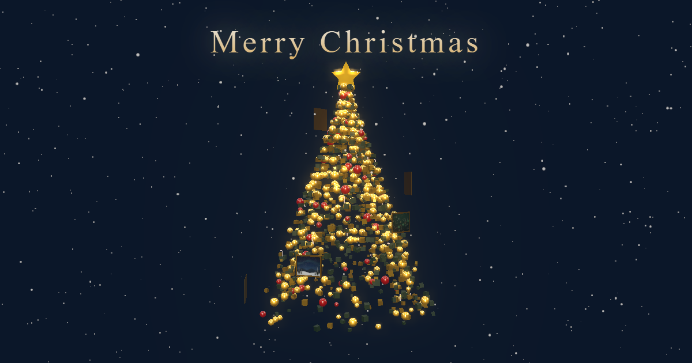

<div align="center">

# 🎄 Grand Luxury Tree

**Wave your hand and watch a Christmas tree made of thousands of particles burst into a nebula.**

[**▶ Live Demo**](https://blacccck88.github.io/gesture-Christmas_tree-3d_with_photo/) · [中文](README.md)

[](https://blacccck88.github.io/gesture-Christmas_tree-3d_with_photo/)
[](https://threejs.org/)
[](https://developers.google.com/mediapipe)
[](LICENSE)



</div>

---

A little project built to celebrate Christmas. ✨

It started as an ordinary 3D Christmas tree, but that felt too tame — so it grew **hand-gesture control** and **particle effects**. Now you can control the tree through your webcam without touching anything, and hang your own photos on it.

Pure front-end. No framework, no build step — **just open the page and play**.

## 🤔 What is this?

Not a static web greeting card, but a living tree made of **thousands of particles**. It uses Google's MediaPipe, so it can read your hands.

* **Particles** — 1500 ornaments, 2000 motes of gold dust, 1000 snowflakes. The tree breathes, spins, and can explode into a starfield.
* **Touchless control** — no mouse needed, just wave at your webcam (Doctor Strange vibes).
* **Hang your memories** — upload photos and they become gold-haloed polaroids that keep gently drifting in the air (each on its own rhythm); pinch to pull one up close while the rest keep floating, still visible.
* **One-click export** — hit `Save Image` for a titled, high-resolution PNG that's ready to share.
* **Restrained palette** — midnight blue and champagne gold, nothing else.


## 🎮 Controls

### 🖐️ Gestures

Allow camera access, then:

| Gesture | Effect |
| --- | --- |
| **Closed fist ✊** | Particles gather back into the tree |
| **Open palm 🖐️** | Explode into a nebula; move your hand to swing the view |
| **Pinch 🤏** | Pull a photo up close — **a different one every pinch** (no repeats until the deck runs out). Don't worry if your fingertips don't actually touch: the *motion* of a quick pinch is enough to trigger it |
| **Both hands 🙌** | Hold one palm open for the nebula while the other hand pinches to pull photos — the two never fight each other |

Detection is normalised by **palm width** (index knuckle ↔ pinky knuckle) rather than wrist-to-knuckle length, because the latter stretches whenever a finger curls — the same pinch would score completely differently depending on how open your hand was.

Pinching is detected on **two channels**: a static threshold that fires when the pinch is firm, and a *dynamic* one that fires on the motion itself (the pinch ratio dropping sharply within ~0.2s). Plenty of people pinch without their fingertips actually touching — the motion signature catches them without false-firing on slow drifts or a relaxing hand. Everything runs behind dual-threshold hysteresis, and mode switches add frame confirmation, so nothing flickers around the boundary.

Thresholds live in `gestures` inside `js/config.js`; press <kbd>D</kbd> to watch both hands' numbers live (`extended fingers / pinch ratio / index reach`) and tune against them.

> Up to two hands are tracked at once. Inference is capped at 30fps so gesture work never starves the render loop.

### 🖱️ Mouse & keyboard

| Input | Effect |
| --- | --- |
| Left-drag | Orbit the camera |
| Scroll | Zoom |
| 「抽一张 🤏」 button | An always-works fallback when gesture detection misfires |
| <kbd>N</kbd> / <kbd>Space</kbd> | Pull the next photo (works without a camera) |
| <kbd>H</kbd> | Hide all UI (great for screenshots and wallpaper recordings) |
| <kbd>T</kbd> / <kbd>S</kbd> | Switch between tree and scattered form |
| <kbd>D</kbd> | Show gesture-detection debug values |
| <kbd>Esc</kbd> | Dismiss the intro overlay |

> The webcam is optional. **Denying permission, having no camera, or failing to load the hand model never blocks the tree** — you simply lose gesture control while mouse and keyboard keep working.

## 🖼️ Use your own photos

Two ways:

**1. Upload in the page (easiest)**
Click `Select Files` for individual images, or `Select Folder` to load a whole directory at once.

> As soon as you upload your own photos, the bundled samples and the "YOUR PHOTO" placeholders are removed automatically — the tree keeps only what you picked.

Every photo is downscaled to a 512px long edge before it reaches the GPU. A 4000×3000 phone shot would otherwise eat ~48MB of VRAM; a few dozen of those hit the WebGL limit, which doesn't throw — the textures just silently turn white, which looks exactly like "the image is broken". After downscaling, 64 photos total about 90MB.

**2. Drop them in `images/`**
Put your photos in `images/`, then list the filenames in `images/manifest.json`:

```json
["photo-01.jpg", "photo-02.jpg", "photo-03.png"]
```

Copy `images/manifest.example.json` as a starting point. If the file doesn't exist the app quietly falls back to the bundled samples in `assets/photos/`.

> `images/` is gitignored, so your personal photos won't be committed by accident.
>
> With no photos at all, the tree hangs a few cream-coloured "YOUR PHOTO" cards — clearly a placeholder, not a broken image.

## 🚀 Run locally

⚠️ **Don't open `index.html` by double-clicking it.** The project uses ES Modules, and webcam access requires a secure context — both break under `file://`. Serve it over HTTP:

```bash
git clone https://github.com/Blacccck88/gesture-Christmas_tree-3d_with_photo.git
cd gesture-Christmas_tree-3d_with_photo

python3 -m http.server 8000   # or: npx http-server .
```

Then open `http://localhost:8000`.

With VS Code, the `Live Server` extension works too: right-click `index.html` → "Open with Live Server".

### URL parameters

| Parameter | Effect |
| --- | --- |
| `?demo=1` | Demo mode: cycles through tree → scatter → photo pull automatically with the UI hidden. Handy for screen recording or big-screen displays. |
| `?quality=high\|medium\|low` | Force a quality tier (auto-detected by default). |
| `?wasm=...` | Base URL of your own MediaPipe wasm mirror (the fastest of a few mirrors is picked automatically by default). |
| `?model=...` | URL of your own `hand_landmarker.task` (the official CDN is used by default). |

## ⚡ Performance

* **Ornaments and dust are drawn with `InstancedMesh`** — 3500 particles cost only a handful of draw calls, so mid-range devices stay smooth.
* **Automatic quality tiers** — touch devices and low core counts get fewer particles and a lower `pixelRatio`. Bloom stays on at every tier, because it *is* the look.
* **Photos are downscaled before upload** — an order of magnitude less VRAM, and folder selection no longer blocks the main thread (decoding happens off-thread, four at a time).
* **Hand inference is capped at 30fps** on its own schedule, outside the render loop.
* Vectors and matrices are reused throughout; the hot path allocates nothing per frame.

## 🛠️ Built with

Pure front-end, no framework and no bundler — dependencies come from a CDN via importmap:

* **[Three.js](https://threejs.org/) 0.160** — rendering, particle system, bloom
* **[MediaPipe Tasks Vision](https://developers.google.com/mediapipe) 0.10** — hand tracking
* **Vanilla JS (ES Modules)** — everything else, hand-rolled

## 📁 Project structure

```
index.html          entry point
css/style.css       styles
js/
  main.js           boot sequence + render loop
  config.js         every tunable (colours, particle counts, gesture thresholds, quality tiers)
  scene.js          renderer / camera / lights / post-processing / orbit controls
  tree.js           ornaments (InstancedMesh), the star, gold dust
  particle.js       how a single particle moves between the tree and the nebula
  photos.js         photo loading, downscaling, gold frames, spiral layout
  focus.js          the "pull a photo up close" animation and deck logic
  snow.js           falling snow
  gestures.js       MediaPipe hand tracking (two hands)
  capture.js        titled image export
  demo.js           ?demo=1 auto-cycling showcase
  ui.js             buttons, intro overlay, shortcuts, status line
  utils.js          damping / easing helpers and procedural textures
assets/photos/      bundled sample photos
images/             drop your own photos here
```

Most things worth tweaking live in `js/config.js`.

## 📄 License

MIT — see [LICENSE](LICENSE).

---

<div align="center">

**Merry Christmas! 🎅**

If this made you smile, a ⭐ would be lovely — or fork it and repaint it in your own colours.

</div>
