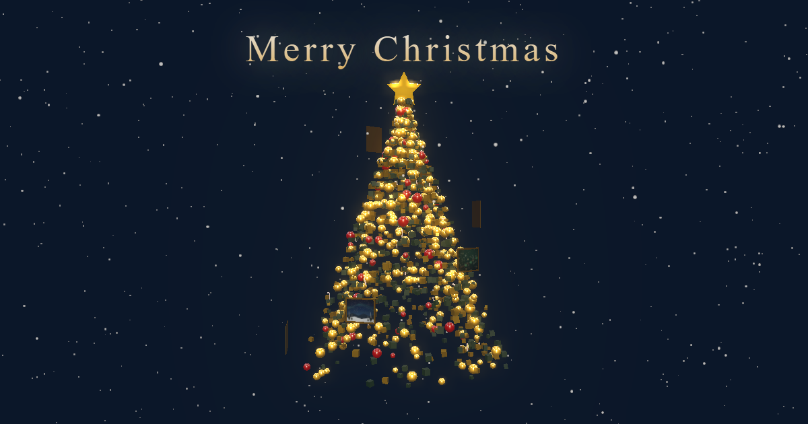

<div align="center">

# 🎄 Grand Luxury Tree

**挥挥手，让一棵由几千个粒子组成的圣诞树炸裂成星云。**

[**▶ 在线体验**](https://blacccck88.github.io/gesture-Christmas_tree-3d_with_photo/) · [English](README.en.md)

[](https://blacccck88.github.io/gesture-Christmas_tree-3d_with_photo/)
[](https://threejs.org/)
[](https://developers.google.com/mediapipe)
[](LICENSE)



</div>

---

哈喽！这是一个为了庆祝圣诞节写的小项目。✨

原本只是想画一棵普通的 3D 圣诞树，但觉得不够酷，于是加上了 **手势识别** 和 **粒子特效**。现在你可以通过摄像头「隔空」控制这棵树，还能把自己喜欢的照片挂上去。

纯前端，没有框架，没有构建步骤，**打开网页就能玩**。

## 🤔 这是啥？(Intro)

这不是那种静态的网页贺卡，而是一棵由 **几千个粒子** 组成的动态树。接入了 Google 的 MediaPipe，所以它能看懂你的手势。

* **粒子特效**：1500 个装饰物 + 2000 粒金尘 + 1000 片雪花，树会呼吸、旋转，还能炸裂成满天星。
* **隔空控物**：不需要鼠标，对着摄像头挥挥手就能控制它（感觉像奇异博士）。
* **挂载回忆**：上传照片，它们会变成带**金色光晕**的拍立得，在空中**持续轻轻飘动**（每张节奏都不同）；捏一下手指就能把其中一张抽到眼前放大，其余照片照常在空中飘着、保持可见。
* **一键出图**：点 `Save Image` 直接导出一张带标题的高清图，发朋友圈刚好。
* **极简审美**：午夜蓝 + 香槟金，主打一个「高级感」。


## 🎮 怎么玩？(Controls)

### 🖐️ 手势模式

确保浏览器允许使用摄像头，然后：

| 手势 | 效果 |
| --- | --- |
| **握紧拳头 ✊** | 收！粒子聚合成圣诞树 |
| **张开手掌 🖐️** | 炸裂模式，树散开成星云，左右移动手掌可以转动视角 |
| **捏合手指 🤏** | 抽一张照片到眼前，**每捏一次换一张**（一轮内不重复）。捏不紧也没关系 —— 「快速捏下去」这个动作本身就能触发 |
| **双手一起 🙌** | 一只手张开保持星云，另一只手捏合抽照片 —— 两个动作互不打扰 |

识别的判定基准是 **掌宽**（食指根 ↔ 小指根），而不是腕到指根的长度 —— 后者手指一伸一屈就会变，同一个捏合动作在手张开时会算出完全不同的比值。

捏合是**双通道**判定：捏得足够紧会触发（静态阈值）；「快速捏下去」这个动作本身也会触发（捏合比在 0.2 秒内大幅下降）—— 有的人捏合时指尖并不贴住，靠动作特征就不挑手型，而慢慢合拢、手放松时的自然漂移都不会误触。判定全程有**双阈值滞回**，形态切换另加连续帧确认，临界点不会来回跳。

阈值都集中在 `js/config.js` 的 `gestures` 里，按 <kbd>D</kbd> 能实时看到两只手的 `手指伸直数 / 捏合比 / 食指伸出度`，方便对着数字调。

> 手势识别最多同时跟两只手。默认按 30fps 推理，剩下的算力留给渲染，免得手势和画面抢帧。

### 🖱️ 鼠标 & 键盘

| 操作 | 效果 |
| --- | --- |
| 左键拖拽 | 旋转视角 |
| 滚轮 | 缩放 |
| 「抽一张 🤏」按钮 | 手势识别不灵时的保底，点一下就抽 |
| <kbd>N</kbd> / <kbd>空格</kbd> | 抽下一张照片（没有摄像头时也能玩） |
| <kbd>H</kbd> | 隐藏所有 UI（截图 / 录屏当壁纸很棒） |
| <kbd>T</kbd> / <kbd>S</kbd> | 手动切换「聚成树」/「散开」 |
| <kbd>D</kbd> | 显示手势识别的调试数值 |
| <kbd>Esc</kbd> | 关闭引导层 |

> 摄像头是可选的。**拒绝授权、没有摄像头、或者手势模型加载失败，都不影响这棵树正常显示**，只是手势控制不可用，鼠标和键盘照常。

## 🖼️ 换成自己的照片

有两种方式：

**1. 页面上传（最简单）**
点右上角 `Select Files` 选图片，或者 `Select Folder` 一次性选一整个文件夹。

> 一上传自己的照片，内置示例图和「YOUR PHOTO」引导卡就会自动撤下，树上只留你选的那几张 —— 不用手动删。

所有照片在进 GPU 之前会先等比缩到长边 512px。手机原图 4000×3000 直接上传要吃掉差不多 48MB 显存，几十张下来 WebGL 会到上限 —— 而且它不报错，只是纹理默默变白，看起来就像「图片挂了」。缩图之后 64 张合计约 90MB，稳得多。

**2. 放进 `images/` 自动加载**
把照片丢进 `images/`，再建一个 `images/manifest.json` 列出文件名：

```json
["photo-01.jpg", "photo-02.jpg", "photo-03.png"]
```

可以直接复制 `images/manifest.example.json` 改。没有这个文件也没关系，会自动回退到 `assets/photos/` 里的内置示例图。

> `images/` 里的内容已经写进 `.gitignore`，你的私人照片不会被误提交上去。
>
> 一张照片都加载不到时，树上会挂几张米白色的「YOUR PHOTO」引导卡 —— 一眼能看出这是「等你放照片」，而不是加载坏了。

## 🚀 本地跑起来 (Run Locally)

⚠️ **别直接双击 `index.html`**。项目用了 ES Modules，而且摄像头只在安全上下文里可用，`file://` 协议下两样都会挂。必须起一个本地服务器：

```bash
git clone https://github.com/Blacccck88/gesture-Christmas_tree-3d_with_photo.git
cd gesture-Christmas_tree-3d_with_photo

python3 -m http.server 8000   # 或者：npx http-server .
```

然后访问 `http://localhost:8000`。

用 VS Code 的话，装个 `Live Server` 插件，右键 `index.html` → "Open with Live Server" 也行。

### URL 参数

| 参数 | 作用 |
| --- | --- |
| `?demo=1` | 演示模式：自动循环「聚成树 → 散开 → 抽一张照片」，并隐藏 UI。录屏、投大屏都合适。 |
| `?quality=high\|medium\|low` | 强制指定画质档位（默认按设备自动判断）。 |
| `?wasm=...` | 自建 MediaPipe wasm 镜像的目录地址（默认自动在几个镜像里挑最快的）。 |
| `?model=...` | 自建手势模型地址（默认取官方 CDN）。国内部署时可以把 `hand_landmarker.task` 放到自己的静态目录里。 |

## ⚡ 性能 (Performance)

* **装饰物和金尘全部走 `InstancedMesh`**，3500 个粒子只产生个位数 draw call —— 中低端设备也能跑满帧。
* **按设备自动分档**：触摸屏 / 低核心数会自动降低粒子数和 `pixelRatio`。辉光（Bloom）在所有档位保留，因为它就是这套画面的灵魂。
* **照片先缩图再上传纹理**：显存占用降一个数量级以上，选文件夹时也不会卡住主线程（解码在别的线程，且并发限 4 张）。
* **手势推理限帧 30fps**，且固定在渲染循环之外单独排队。
* 每帧的向量和矩阵全部复用，热路径上没有临时对象分配。

## 🛠️ 用了什么 (Tech)

纯前端，没有框架，没有打包工具，依赖通过 importmap 从 CDN 引入：

* **[Three.js](https://threejs.org/) 0.160** — 3D 渲染、粒子系统、Bloom 后期
* **[MediaPipe Tasks Vision](https://developers.google.com/mediapipe) 0.10** — 手势识别（支持双手）
* **原生 JS (ES Modules)** — 手搓核心逻辑

## 📁 项目结构

```
index.html          入口
css/style.css       样式
js/
  main.js           启动流程 + 渲染主循环
  config.js         所有可调参数（颜色、粒子数、手势阈值、画质分档…）
  scene.js          渲染器 / 相机 / 灯光 / 后期 / 鼠标控制
  tree.js           树身装饰物（InstancedMesh）、顶端星星、金尘
  particle.js       单个粒子在「树形 / 散开」之间的运动
  photos.js         照片加载、缩图、金框、螺旋排布
  focus.js          「抽一张照片到眼前」的动画与取牌逻辑
  snow.js           飘雪
  gestures.js       MediaPipe 手势识别（双手）
  capture.js        导出带标题的成品图
  demo.js           ?demo=1 自动循环演示
  ui.js             按钮、引导层、快捷键、状态提示
  utils.js          阻尼 / 缓动函数与程序化生成的贴图
assets/photos/      内置示例图
images/             放你自己的照片
```

想调效果的话，绝大多数参数都集中在 `js/config.js` 一个文件里。

## 📄 License

MIT，见 [LICENSE](LICENSE)。

---

<div align="center">

**Merry Christmas! 🎅**

如果你觉得这项目有点意思，欢迎 Star ⭐，或者 Fork 改成你喜欢的颜色！

</div>
